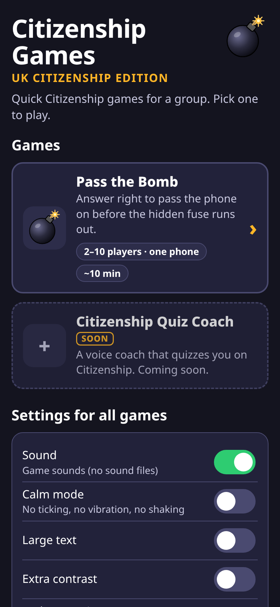
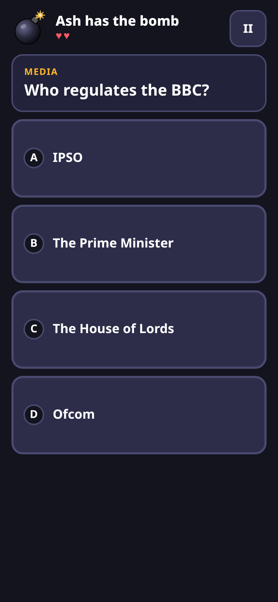

# Citizenship

A single web page of quiz games for Citizenship PGCE trainees and aspiring teachers. Use it to revise your own UK Citizenship subject knowledge.

Open `index.html` in a phone or laptop browser. There is nothing to install and no account to create. The page works offline.

## Games

**Pass the Bomb** is for 2–10 people, on one phone, and takes about 10 minutes. Answer correctly to pass the phone on. Whoever is holding it when the hidden fuse runs out loses a life. There are 52 UK Citizenship questions, with pause and calm mode.

**Citizenship Quiz Coach** is coming soon: a voice coach that quizzes you on Citizenship. The tile cannot be opened yet.

## How to play on a phone

1. Open the page on one phone and tap **Pass the Bomb**.
2. Choose how many people are playing. Nicknames are optional and are never saved.
3. Tap **Start**. Pass the phone to the person the bomb starts with.
4. They tap to light the fuse and answer. A right answer names who to pass the phone to. A wrong answer keeps the bomb with them for a moment, then shows a new question.
5. The fuse keeps burning while the phone is being passed.

Every game has an **‹ All games** button. Leaving a game that is in progress asks you to confirm first. The fuse, the sound and the screen wake lock then stop.

You can open a screen directly:

- `#/` is the home screen
- `#/pass-the-bomb` is Pass the Bomb

## Settings

Sound, calm mode, large text, extra contrast and reduce motion apply in every game. They are saved on the phone. Reduce motion switches on automatically if the phone asks for it. Calm mode turns off ticking, vibration and shaking. Sound is made in the browser, so there are no sound files.

## Facts

The Pass the Bomb questions were checked against official UK sources in October 2026. Facts can change, so check again before relying on them. Each question keeps a link to its source.

## Screenshots

Home screen, with Pass the Bomb, Citizenship Quiz Coach marked soon, and the shared settings.

A Pass the Bomb question.

